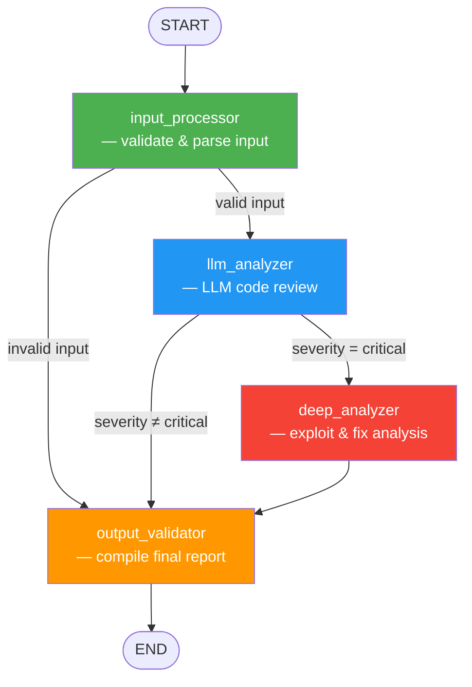

# LangGraph Code Review Agent

A production-quality **automated code review agent** built with [LangGraph](https://github.com/langchain-ai/langgraph), [LangChain](https://www.langchain.com/), and [Groq](https://groq.com/) (LLaMA 3.3 70B).

The agent analyses source code for bugs, security vulnerabilities, style violations, and performance issues — then compiles a structured report with actionable recommendations.

---

## Architecture



### Processing Pipeline

| Step | Node | Description |
|------|------|-------------|
| 1 | **input_processor** | Validates the input is non-empty source code. Detects language, counts lines, checks for functions/classes/imports. |
| 2 | **llm_analyzer** | Sends the code to LLaMA 3.3 70B via Groq for structured review (bugs, security, style, performance). |
| 3 | **deep_analyzer** | *(conditional — critical severity only)* Performs deeper analysis: fix suggestions, exploit scenarios, root-cause analysis. |
| 4 | **output_validator** | Compiles all findings into a validated final report with recommendations and timestamps. |

---

## State Schema

The agent uses a shared `CodeReviewState` (TypedDict) that flows through every node:

| Field | Type | Description |
|-------|------|-------------|
| `code` | `str` | Raw source code to review |
| `language` | `str` | Programming language (`"auto"` for detection) |
| `is_valid_input` | `bool` | Whether the input passed validation |
| `parsed_info` | `dict` | Metadata — line count, has functions/classes/imports |
| `review_result` | `dict` | Raw LLM analysis (bugs, security, style, performance) |
| `severity` | `str` | `"critical"` \| `"warning"` \| `"info"` \| `"clean"` |
| `deep_analysis` | `dict` | Detailed analysis for critical findings |
| `final_report` | `dict` | The structured output report |
| `errors` | `list[str]` | Error messages accumulated during processing |

Fields with `Annotated` reducers (`parsed_info`, `review_result`, `deep_analysis`, `final_report`) merge dicts across nodes. `errors` appends new entries.

---

## Installation

```bash
# 1. Navigate to the project directory
cd 1_langgraph_agent

# 2. Create and activate a virtual environment (recommended)
python -m venv venv
venv\Scripts\activate        # Windows
# source venv/bin/activate   # macOS / Linux

# 3. Install dependencies
pip install -r requirements.txt
```

## Configuration

Create a `.env` file (or use the one provided):

```env
GROQ_API_KEY=your_groq_api_key_here
```

---

## Usage

### Run the Agent (with test inputs)

```bash
python agent.py
```

This loads test cases from `../shared/test_inputs.json`, runs each through the review pipeline, prints formatted results, and saves output to `results.json`.

### Run the Test Harness

```bash
python test_agent.py
```

Runs all test cases with pass/fail validation against expected severities, measures execution time, and saves detailed results to `test_results.json`.

### Use as a Library

```python
from agent import run_review

report = run_review(
    code="def foo(x): return eval(x)",
    language="python",
)

print(report["severity"])         # "critical"
print(report["recommendations"])  # ["Security: Use of eval()...", ...]
```

---

## Example Output

```json
{
  "status": "reviewed",
  "input_summary": {
    "language": "python",
    "line_count": 14,
    "non_empty_line_count": 12,
    "has_functions": true,
    "has_classes": false
  },
  "findings": {
    "bugs": [],
    "security_issues": [
      "SQL injection via string concatenation in query building"
    ],
    "style_issues": [
      "No type hints on function parameters"
    ],
    "performance_issues": [],
    "overall_quality": "poor",
    "summary": "Critical SQL injection vulnerability detected."
  },
  "severity": "critical",
  "deep_analysis": {
    "fix_suggestions": [
      {
        "issue": "SQL Injection",
        "fix": "Use parameterized queries",
        "corrected_code": "cursor.execute('SELECT * FROM users WHERE username = ?', (username,))"
      }
    ],
    "exploit_scenarios": [
      {
        "vulnerability": "SQL Injection",
        "scenario": "Attacker passes `' OR '1'='1` as username",
        "impact": "Full database access"
      }
    ]
  },
  "recommendations": [
    "Security: SQL injection via string concatenation",
    "Style: No type hints on function parameters"
  ],
  "timestamp": "2026-10-20T06:40:00+00:00"
}
```

---

## Project Structure

```
1_langgraph_agent/
├── .env                 # API key configuration
├── requirements.txt     # Python dependencies
├── state.py             # CodeReviewState TypedDict definition
├── nodes.py             # 4 node functions (processing steps)
├── agent.py             # LangGraph pipeline + CLI entry point
├── test_agent.py        # Test harness with pass/fail validation
├── results.json         # Generated — agent run output
├── test_results.json    # Generated — test harness output
└── README.md            # This file
```
