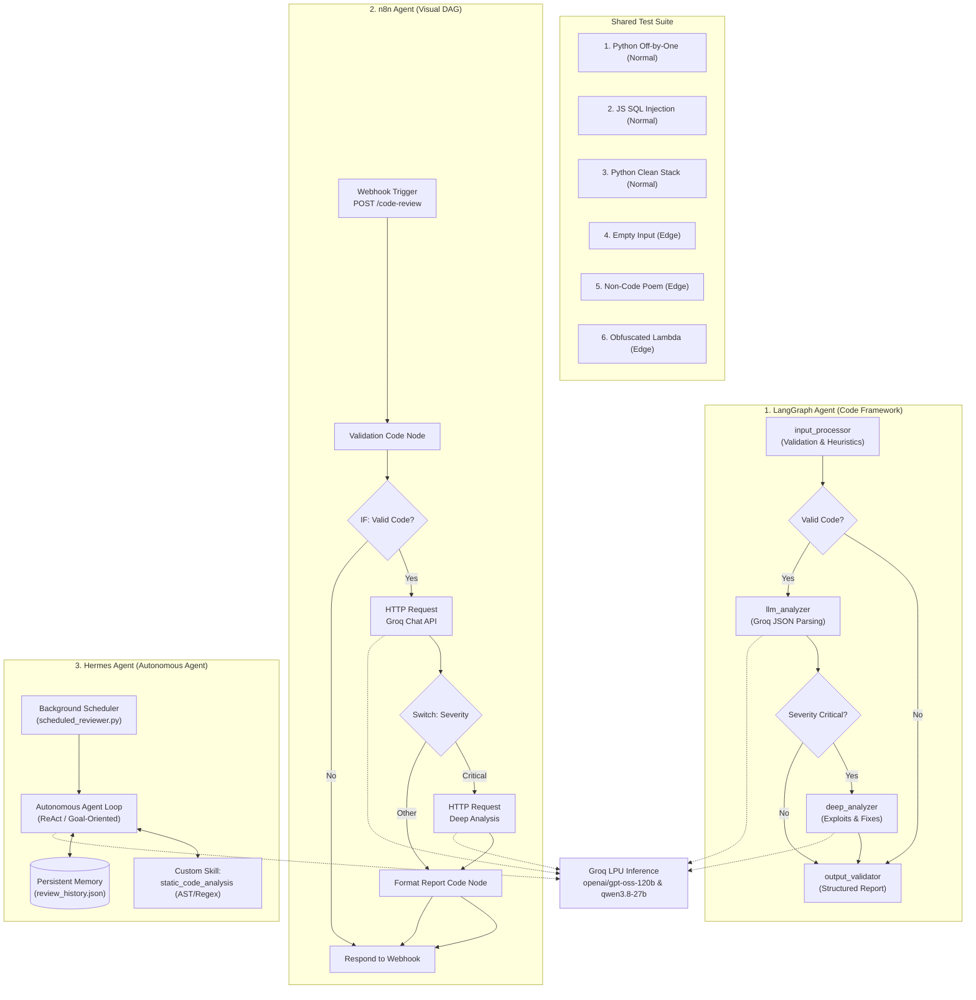

# 🧪 AI Agent Comparison Lab

**Comparing three distinct approaches to building AI agents — a Programming Framework (LangGraph), a Visual Workflow Automation Platform (n8n), and a Ready-Made Autonomous Agent (Hermes Agent).**

All three build the **same Code Review Agent** using the same LLM backend (**Groq API**) and the same test suite.

---

## 🎯 Purpose & Agent Selection

- **Chosen Agent:** **Code Review Agent** (#4)  
  Analyzes source code across languages for syntax errors, logic bugs (e.g. off-by-one errors), security vulnerabilities (e.g. SQL injection, XSS, hardcoded credentials), and code style/maintainability.
- **Goal:** Understand:
  1. How much **control** each tool gives over every step.
  2. Which tool is the **fastest to build** with, and which is easiest to **modify and debug**.
  3. How each handles **normal vs. unexpected inputs** (empty code, poems, obfuscated one-liners).
  4. Which tool fits **production systems**, **business automations**, and **personal assistants**.

---

## 📁 Project Structure

```
agent lab/
├── README.md                      ← Master documentation (this file)
│
├── 1_langgraph_agent/             ← Tool Type 1: Programming Framework (Python)
│   ├── .env                       ← Groq API key configuration
│   ├── requirements.txt           ← Dependencies (langgraph, langchain-groq, etc.)
│   ├── state.py                   ← Shared evolving state schema (TypedDict + reducers)
│   ├── nodes.py                   ← 4 discrete processing nodes + AST/heuristics
│   ├── agent.py                   ← StateGraph wiring + conditional edges + run API
│   ├── test_agent.py              ← Test runner across all 6 test cases
│   └── README.md
│
├── 2_n8n_agent/                   ← Tool Type 2: Visual Workflow Automation (n8n)
│   ├── workflow.json              ← Complete importable n8n workflow definition
│   ├── setup_guide.md             ← Step-by-step setup (Docker, npm, npx, Groq credentials)
│   ├── test_inputs.json           ← Standardized webhook test payloads
│   ├── test_workflow.py           ← Automated webhook test runner & timer
│   └── README.md
│
├── 3_hermes_agent/                ← Tool Type 3: Ready-Made Autonomous Agent (Hermes Agent)
│   ├── config.yaml                ← Hermes agent configuration (Groq provider + features)
│   ├── agent_runner.py            ← Runner demonstrating dual mode & persistent memory
│   ├── scheduled_reviewer.py      ← Background recurring task watcher (unique feature)
│   ├── skills/
│   │   ├── __init__.py
│   │   └── code_review_skill.py   ← Custom AST + regex static analysis tool
│   ├── memory_store/              ← Persistent memory storage across sessions
│   ├── setup_guide.md             ← Official installation & usage guide
│   └── README.md
│
└── shared/                        ← Shared Benchmarks & Reports
    ├── test_inputs.json           ← 6 standardized test inputs (3 normal + 3 edge)
    └── comparison_report.md       ← Comprehensive evaluation & architecture decisions
```

---

## 🏗️ Architecture Comparison



---

## 🚀 How to Run Each Project

### 1. LangGraph Agent (`1_langgraph_agent/`)
```bash
cd 1_langgraph_agent
pip install -r requirements.txt
python agent.py
# Or run the automated test suite:
python test_agent.py
```

### 2. n8n Agent (`2_n8n_agent/`)
1. Start n8n via Docker or npm:
   ```bash
   npx n8n
   ```
2. Open `http://localhost:5678` in your browser.
3. Click **Workflows** → **Import from File** → select `2_n8n_agent/workflow.json`.
4. Add your Groq API key in the HTTP Request nodes or as an n8n header credential.
5. Test with Python:
   ```bash
   cd 2_n8n_agent
   python test_workflow.py
   ```

### 3. Hermes Agent (`3_hermes_agent/`)
```bash
cd 3_hermes_agent
# Run test suite across all 6 cases with persistent memory:
python agent_runner.py --standalone

# Run persistent memory demo across sessions:
python agent_runner.py --standalone

# Run background scheduled watcher on code directory:
python scheduled_reviewer.py --interval 30 --watch-dir ./code_to_review
```

---

## 📊 Summary of Findings

| Criterion | LangGraph | n8n | Hermes Agent |
|---|---|---|---|
| **Control Level** | **Maximum (10/10)**: You own every line of code, state key, and routing edge. | **Medium (7/10)**: Visual wiring and JSON node manipulation. | **Autonomous (5/10)**: Goal-oriented tool invocation loop. |
| **Speed to Build** | Slower initial setup (schemas, typed dicts, graph wiring). | Fast visual drag-and-drop workflow assembly. | **Fastest**: Write one skill function and configure YAML. |
| **Debuggability** | **Best for developers**: Standard Python tracebacks, unit tests, and breakpoints. | **Best for visual debugging**: Click any node to see in/out JSON payloads. | Harder to debug non-deterministic autonomous decisions. |
| **Edge-Case Resilience** | **Highest**: Pre-processing guards prevent invalid inputs from wasting LLM tokens. | High: Conditional IF nodes branch errors immediately. | Good: Skill catches errors, but LLM still called if not guarded. |
| **Best Used For** | **Production Systems & CI/CD** (deterministic, type-safe, testable). | **Business Automation** (connects 400+ SaaS apps, webhooks, Slack/Jira). | **Personal Assistant** (persistent memory, scheduled background scans). |

Read the full evaluation in [`shared/comparison_report.md`](file:///c:/Users/Dell/Documents/AI_projects/projects/agent%20lab/shared/comparison_report.md).
